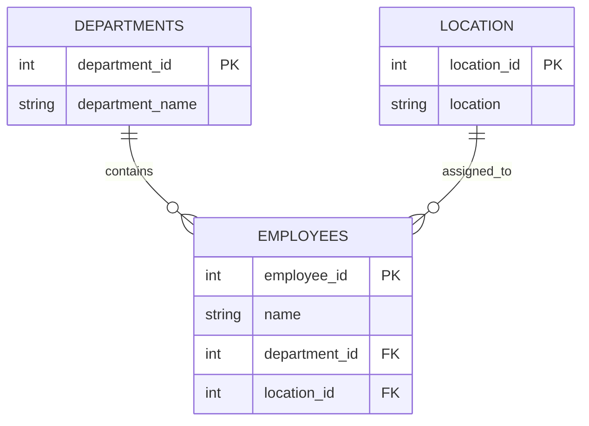

<h1>🗄️ DATABASE DESIGN STUDIO</h1><h3>MYSQL DDL · EMPLOYEE SCHEMA</h3>

> [!CAUTION]
> The scripts contain `DROP DATABASE`, `DROP TABLE` and `TRUNCATE`. Run only in a disposable MySQL environment. Never use production or important data.

## Relational blueprint

## Schema operation palette
<table><tr><td><b>CREATE</b> Build database objects</td><td><b>ALTER</b> Change table structure</td><td><b>RENAME</b> Change object name</td></tr><tr><td><b>TRUNCATE</b> Remove all rows</td><td><b>DROP TABLE</b> Remove a table</td><td><b>DROP DATABASE</b> Remove a database</td></tr></table>

## Integrity constraints
`PRIMARY KEY` · `FOREIGN KEY` · `NOT NULL` · `UNIQUE` · `AUTO_INCREMENT` · `CHECK` · `DEFAULT` · `ENUM`

## Script library
- [DDL commands & constraints](sql/DDL%20Commands%20%26%20Constraints%20-%20Assignment%201.sql)
- [Employee database build](sql/employee_database.sql)

## Safe execution protocol
`READ → CHECK TARGET → BACK UP → USE SANDBOX → RUN IN SECTIONS → VERIFY`

This workshop teaches schema structure and integrity rules, not business analysis.