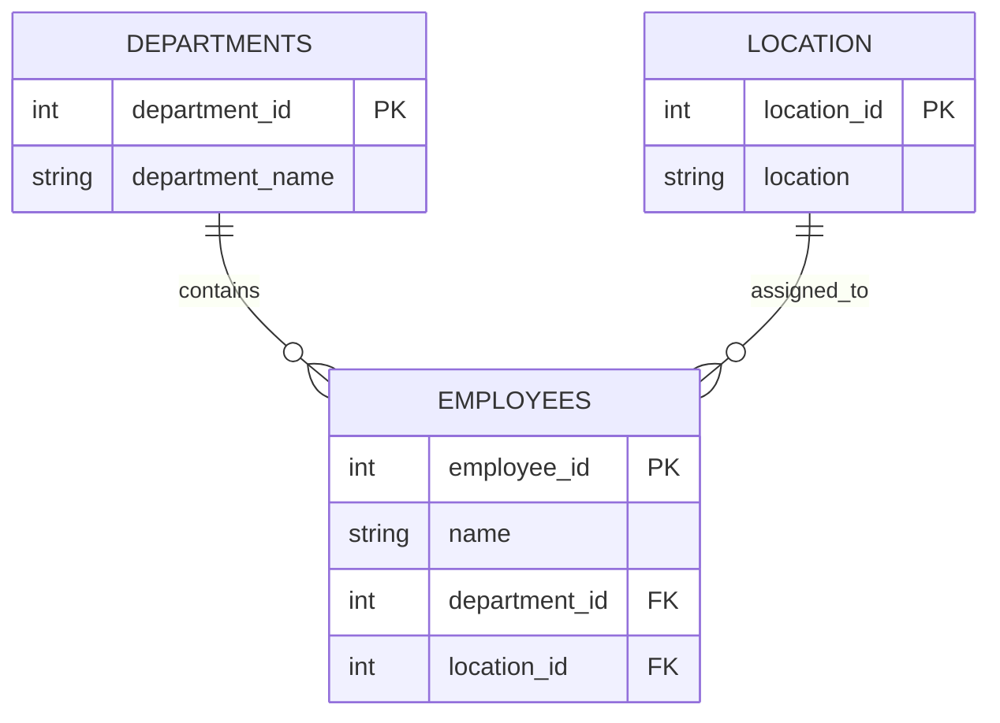

# 🗄️ MYSQL SCHEMA DESIGN WORKSHOP
### Employee database · DDL and integrity constraints

> [!CAUTION]
> Scripts include DROP DATABASE, DROP TABLE and TRUNCATE operations. Use a disposable MySQL environment only. Never execute against production or important data.

## Relational blueprint

## DDL command palette
| Command | Function |
|---|---|
| CREATE DATABASE / TABLE | Build objects |
| ALTER TABLE | Change definition |
| RENAME TABLE | Rename object |
| TRUNCATE TABLE | Empty rows |
| DROP TABLE / DATABASE | Remove objects |

## Constraint test bench
`PRIMARY KEY` · `NOT NULL` · `UNIQUE` · `AUTO_INCREMENT` · `ENUM` · `CHECK` · `DEFAULT` · `FOREIGN KEY`

Test cases include duplicate identifiers, missing values, invalid gender/age, duplicate locations and invalid foreign-key references.

## SQL scripts
- [DDL commands and constraints](sql/DDL%20Commands%20%26%20Constraints%20-%20Assignment%201.sql)
- [Employee database script](sql/employee_database.sql)

## Safe lab protocol
`READ SCRIPT → CONFIRM TARGET → USE PRACTICE DATABASE → RUN IN SECTIONS → INSPECT RESULTS`

This workshop focuses on database structure and integrity, not business analysis.